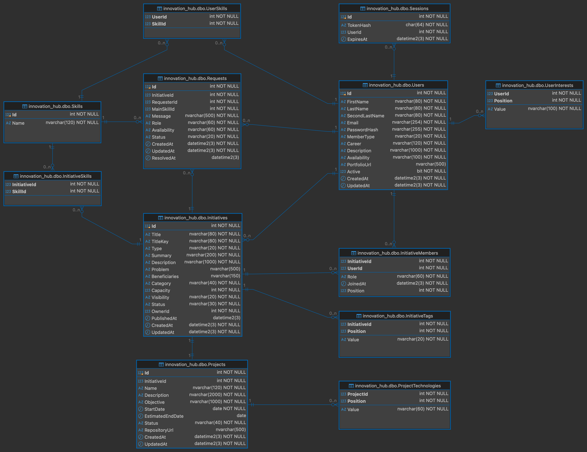

# Modelo de datos SQL Server

Este documento describe las tablas y relaciones propuestas para la base de datos del Innovation Hub en SQL Server. El diseño parte de los datos que actualmente guarda la aplicación en MongoDB.

## Diagrama

El diagrama muestra las tablas y cómo se relacionan. En las tablas siguientes, `PK` identifica la llave primaria y `FK` la llave foránea. Las tablas que guardan listas incluyen una posición para conservar el orden original de sus elementos.

**Aclaración:** el diagrama muestra `1` en ambos extremos de la relación entre `Initiatives` y `Projects`. En el modelo, cada proyecto pertenece a una iniciativa, pero una iniciativa puede existir sin proyecto y generar como máximo uno. La restricción `UNIQUE` sobre `Projects.InitiativeId` garantiza ese máximo.

- **Usuario–competencia:** muchos a muchos mediante `UserSkills`.
- **Usuario–iniciativa:** uno a muchos como propietario (`Initiatives.OwnerId`); muchos a muchos como integrante mediante `InitiativeMembers`, con rol y fecha.
- **Iniciativa–competencia:** muchos a muchos mediante `InitiativeSkills`.
- **Iniciativa–solicitud:** uno a muchos mediante `Requests.InitiativeId`.
- **Proyecto–iniciativa:** una iniciativa tiene cero o un proyecto, y cada proyecto una iniciativa: FK obligatoria y `UNIQUE` en `Projects.InitiativeId`.
- **Proyecto–usuario:** muchos a muchos derivada de proyecto → iniciativa → miembros; el propietario se obtiene de `Initiatives.OwnerId`. No se duplica el equipo y, como en Express, el proyecto refleja el equipo actual, no una instantánea histórica.

### Del documento a la tabla

En el Avance 2, la aplicación guarda la información en colecciones de MongoDB. La siguiente tabla muestra dónde quedará cada colección y cada arreglo en el modelo relacional, y explica por qué se hizo cada cambio.

| Origen MongoDB | Destino SQL Server | Motivo |
|---|---|---|
| `users` y sus campos escalares | `Users` | Una fila por usuario; `_id` se traduce a `Id`. |
| `users.skills[]` | `UserSkills` | Referencias compartidas; relación N:M. |
| `users.interests[]` | `UserInterests` | Valores multivaluados con posición; conserva duplicados y orden. |
| `skills` | `Skills` | Catálogo compartido con nombre único. |
| `initiatives` y `ownerId` | `Initiatives`, `OwnerId` → `Users` | Una fila por iniciativa y propietario existente. |
| `initiatives.skills[]` | `InitiativeSkills` | Referencias compartidas N:M. |
| `initiatives.members[]` y `members.userId` | `InitiativeMembers`, `UserId` → `Users` | Se conservan usuario, rol y fecha de incorporación. |
| `initiatives.tags[]` | `InitiativeTags` | Valores multivaluados con posición. |
| `requests`, `initiativeId`, `requesterId`, `mainSkillId` | `Requests` y tres FK a `Initiatives`, `Users`, `Skills` | Conserva solicitudes y referencias independientes. |
| `projects`, `initiativeId` | `Projects` y FK única a `Initiatives` | Una iniciativa origina como máximo un proyecto. |
| `projects.technologies[]` | `ProjectTechnologies` | Conserva orden y duplicados admitidos por Express. |
| `sessions`, `userId` | `Sessions` y FK a `Users` | Conserva hash y vencimiento; no el token original. |

## Tablas

Cada tabla indica el tipo de sus columnas, si son obligatorias y las reglas que deben cumplir. `Sí` equivale a `NOT NULL`; las columnas que forman una llave primaria compuesta son obligatorias.

Las llaves foráneas usan `ON DELETE NO ACTION`: SQL Server impide borrar un registro mientras otra tabla lo siga utilizando. Si corresponde eliminar datos relacionados, la aplicación debe hacerlo explícitamente dentro de una transacción. Los identificadores numéricos usan `INT IDENTITY(1,1)`, las fechas con hora se guardan en UTC y las posiciones comienzan en cero.

Algunas reglas requieren validación en la aplicación y operaciones transaccionales: comprobar que el propietario esté activo y forme parte del equipo, respetar el cupo, exigir al menos una competencia por iniciativa y verificar que la competencia principal de una solicitud pertenezca a esa iniciativa. También se deben validar las condiciones para aceptar solicitudes y convertir una iniciativa en proyecto. Estas reglas no quedan garantizadas solo con las restricciones de las tablas.

### Users

| Columna | Tipo | ¿Obligatoria? | Llave | Regla |
|---|---|---|---|---|
| Id | INT IDENTITY | Sí | PK | |
| FirstName | NVARCHAR(80) | Sí | | Nombre |
| LastName | NVARCHAR(80) | Sí | | Primer apellido |
| SecondLastName | NVARCHAR(80) | Sí | | Puede ser cadena vacía |
| Email | NVARCHAR(254) | Sí | | UNIQUE; normalizado por la aplicación |
| PasswordHash | NVARCHAR(255) | Sí | | Hash bcrypt; nunca se devuelve |
| MemberType | NVARCHAR(20) | Sí | | CHECK IN (N'Estudiante', N'Docente', N'Administrativo') |
| Career | NVARCHAR(120) | Sí | | |
| Description | NVARCHAR(1000) | Sí | | Puede ser cadena vacía |
| Availability | NVARCHAR(100) | Sí | | Puede ser cadena vacía |
| PortfolioUrl | NVARCHAR(500) | No | | NULL cuando no hay dirección |
| Active | BIT | Sí | | 0 o 1 |
| CreatedAt | DATETIME2(3) | Sí | | UTC |
| UpdatedAt | DATETIME2(3) | Sí | | UTC |

### Skills

| Columna | Tipo | ¿Obligatoria? | Llave | Regla |
|---|---|---|---|---|
| Id | INT IDENTITY | Sí | PK | |
| Name | NVARCHAR(120) | Sí | | UNIQUE |

### UserSkills

| Columna | Tipo | ¿Obligatoria? | Llave | Regla |
|---|---|---|---|---|
| UserId | INT | Sí | PK, FK | → Users; borrado NO ACTION |
| SkillId | INT | Sí | PK, FK | → Skills; borrado NO ACTION |

### UserInterests

| Columna | Tipo | ¿Obligatoria? | Llave | Regla |
|---|---|---|---|---|
| UserId | INT | Sí | PK, FK | → Users; borrado NO ACTION |
| Position | INT | Sí | PK | CHECK (Position >= 0) |
| Value | NVARCHAR(100) | Sí | | |

### Initiatives

| Columna | Tipo | ¿Obligatoria? | Llave | Regla |
|---|---|---|---|---|
| Id | INT IDENTITY | Sí | PK | |
| Title | NVARCHAR(80) | Sí | | |
| TitleKey | NVARCHAR(80) | Sí | | UNIQUE; título normalizado por la aplicación |
| Type | NVARCHAR(20) | Sí | | CHECK IN (N'Idea', N'Necesidad', N'Reto') |
| Summary | NVARCHAR(200) | Sí | | |
| Description | NVARCHAR(1000) | Sí | | |
| Problem | NVARCHAR(500) | No | | |
| Beneficiaries | NVARCHAR(150) | No | | |
| Category | NVARCHAR(40) | Sí | | CHECK IN (N'Tecnología', N'Educación', N'Sostenibilidad', N'Impacto social', N'Negocios y emprendimiento', N'Salud y bienestar', N'Cultura y creatividad', N'Otro') |
| Capacity | INT | Sí | | CHECK (Capacity BETWEEN 1 AND 20); incluye propietario |
| Visibility | NVARCHAR(20) | Sí | | CHECK IN (N'Pública', N'Institucional', N'Restringida', N'Privada') |
| Status | NVARCHAR(30) | Sí | | CHECK IN (N'Borrador', N'Publicada', N'En formación de equipo', N'Convertida en proyecto', N'Archivada') |
| OwnerId | INT | Sí | FK | → Users; borrado NO ACTION |
| PublishedAt | DATETIME2(3) | No | | UTC |
| CreatedAt | DATETIME2(3) | Sí | | UTC |
| UpdatedAt | DATETIME2(3) | Sí | | UTC |

### InitiativeSkills

| Columna | Tipo | ¿Obligatoria? | Llave | Regla |
|---|---|---|---|---|
| InitiativeId | INT | Sí | PK, FK | → Initiatives; borrado NO ACTION |
| SkillId | INT | Sí | PK, FK | → Skills; borrado NO ACTION |

### InitiativeMembers

| Columna | Tipo | ¿Obligatoria? | Llave | Regla |
|---|---|---|---|---|
| InitiativeId | INT | Sí | PK, FK | → Initiatives; borrado NO ACTION |
| UserId | INT | Sí | PK, FK | → Users; borrado NO ACTION |
| Role | NVARCHAR(60) | Sí | | Incluye `Propietario` |
| JoinedAt | DATETIME2(3) | Sí | | UTC |
| Position | INT | Sí | | CHECK >= 0; UNIQUE (InitiativeId, Position), conserva orden de members |

### InitiativeTags

| Columna | Tipo | ¿Obligatoria? | Llave | Regla |
|---|---|---|---|---|
| InitiativeId | INT | Sí | PK, FK | → Initiatives; borrado NO ACTION |
| Position | INT | Sí | PK | CHECK (Position >= 0) |
| Value | NVARCHAR(20) | Sí | | UNIQUE (InitiativeId, Value), con comparación sin distinción de mayúsculas |

### Requests

| Columna | Tipo | ¿Obligatoria? | Llave | Regla |
|---|---|---|---|---|
| Id | INT IDENTITY | Sí | PK | |
| InitiativeId | INT | Sí | FK | → Initiatives; borrado NO ACTION |
| RequesterId | INT | Sí | FK | → Users; borrado NO ACTION |
| MainSkillId | INT | Sí | FK | → Skills; borrado NO ACTION |
| Message | NVARCHAR(500) | Sí | | |
| Role | NVARCHAR(60) | Sí | | |
| Availability | NVARCHAR(60) | Sí | | |
| Status | NVARCHAR(20) | Sí | | CHECK IN (N'Pendiente', N'Aceptada', N'Rechazada', N'Cancelada') |
| CreatedAt | DATETIME2(3) | Sí | | UTC |
| UpdatedAt | DATETIME2(3) | Sí | | UTC |
| ResolvedAt | DATETIME2(3) | No | | UTC; cancelación puede dejar NULL |

Índice único filtrado: `CREATE UNIQUE INDEX UX_Requests_Pending ON Requests(InitiativeId, RequesterId) WHERE Status = N'Pendiente';`. Permite solicitudes históricas, pero una sola pendiente por persona e iniciativa.

### Projects

| Columna | Tipo | ¿Obligatoria? | Llave | Regla |
|---|---|---|---|---|
| Id | INT IDENTITY | Sí | PK | |
| InitiativeId | INT | Sí | FK | → Initiatives; UNIQUE; borrado NO ACTION |
| Name | NVARCHAR(120) | Sí | | |
| Description | NVARCHAR(2000) | Sí | | |
| Objective | NVARCHAR(1000) | Sí | | |
| StartDate | DATE | Sí | | La API lo muestra como `YYYY-MM-DD` |
| EstimatedEndDate | DATE | No | | La API lo muestra como `YYYY-MM-DD` |
| Status | NVARCHAR(40) | Sí | | Estado del proyecto |
| RepositoryUrl | NVARCHAR(500) | No | | URL de GitHub validada por aplicación |
| CreatedAt | DATETIME2(3) | Sí | | UTC |
| UpdatedAt | DATETIME2(3) | Sí | | UTC |

### ProjectTechnologies

| Columna | Tipo | ¿Obligatoria? | Llave | Regla |
|---|---|---|---|---|
| ProjectId | INT | Sí | PK, FK | → Projects; borrado NO ACTION |
| Position | INT | Sí | PK | CHECK (Position >= 0) |
| Value | NVARCHAR(60) | Sí | | |

### Sessions

| Columna | Tipo | ¿Obligatoria? | Llave | Regla |
|---|---|---|---|---|
| Id | INT IDENTITY | Sí | PK | |
| TokenHash | CHAR(64) | Sí | | UNIQUE; SHA-256 hexadecimal |
| UserId | INT | Sí | FK | → Users; borrado NO ACTION |
| ExpiresAt | DATETIME2(3) | Sí | | UTC; índice para limpieza por vencimiento |

SQL Server no elimina las sesiones vencidas automáticamente como lo hace el índice TTL de MongoDB. La aplicación debe rechazar las sesiones vencidas y un proceso de mantenimiento debe eliminarlas.

## Plan de migración

Consulte el [plan de migración y los datos de prueba](plan-migracion.md).
